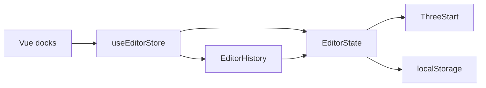

# Architecture

This page is the code map.
The user tasks are on the other pages.

## Boot

`index.html` loads `src/main.ts`.
`main.ts` creates Vue, Pinia, and the router.
`src/editor/App.vue` renders `router-view`.
`vite.config.ts` enables the Vue plugin.
There is no second HTML page for the editor.

| Route | Component |
| --- | --- |
| `/` | `src/editor/pages/ScenePage.vue` |
| `/editor` | `src/editor/pages/EditorPage.vue` |

`ScenePage` calls `useMountedScene`.
`Viewport.vue` calls `useMountedScene` on `/editor`.
The hook is `src/editor/scene/useMountedScene.ts`.
A generation ticket ignores a late release from an old route.

## One ThreeStart

`src/webgl/index.ts` builds one `ThreeStart`.
The name in that module is `starter`.
`bootScene(container)` boots once, then moves the canvas.
`releaseScene(container)` unmounts only when that container still owns the canvas.

The first `EditorState.attach` does this work.

1. Reparent the starter children under World.
2. Register those objects in the node map.
3. Add the grid, the environment, and `TransformControls`.
4. Load `readSceneFile` for the open path, or create a WorldEnvironment.
5. Subscribe to the frame update.

A second visit only calls `setChromeVisible(true)`.
Leave the viewport and `hideChrome` runs.
The nodes stay in the scene.

## Two layers

| Layer | File | Owns |
| --- | --- | --- |
| Engine | `src/editor/state.ts` | Nodes, Three.js objects, pick, save, signals. |
| Store | `src/editor/stores/editor.ts` | Vue state, menus, history, pointer binding. |

The store holds `engine` with `markRaw`.
Vue does not make the Three.js graph reactive.
After a mutation the store calls `touch`.
`touch` increments `revision`.
Computed snapshots read `revision` and then read the engine.

## Frame

`onFrame` runs from the Three.js update.
It aims lights that use Look at.
It syncs the view camera.
It updates camera helpers.
It updates selection boxes and light icons.

## Scripts and materials

`behaviors.ts` compiles a component with Sucrase.
`sceneApi.ts` is the bridge into groups and signals.
`bindSceneRuntime` connects that bridge in the `EditorState` constructor.
`tsl.ts` compiles a material with `new Function`.

## Save and undo

`sceneFile.ts` is the schema and the `localStorage` access.
`captureScene` and `applyScene` move between the live graph and a `SceneFile`.
`history.ts` stores pairs of those files.
Undo calls `restoreHistory`.

## Files

| Path | Role |
| --- | --- |
| `src/editor/state.ts` | `EditorState` and `NODE_TYPES`. |
| `src/editor/stores/editor.ts` | Pinia store. |
| `src/editor/sceneFile.ts` | Scene schema and storage. |
| `src/editor/history.ts` | Undo stack. |
| `src/editor/behaviors.ts` | Component compile. |
| `src/editor/sceneApi.ts` | Script API. |
| `src/editor/signals.ts` | Signal names and `SignalBus`. |
| `src/editor/groups.ts` | Group names and global storage. |
| `src/editor/camera.ts` | Camera settings. |
| `src/editor/environment.ts` | WorldEnvironment settings. |
| `src/editor/geometry.ts` | Geometry catalog. |
| `src/editor/tsl.ts` | TSL presets and compile. |
| `src/editor/lightIcons.ts` | Light badges, arrow, and spot cone. |
| `src/editor/editor.css` | Shared layout CSS. |
| `src/webgl/index.ts` | `ThreeStart` boot and debug shading. |

## See also

[[Getting started]]
[[Scene file format]]
[[Limits]]
[[Home]]
