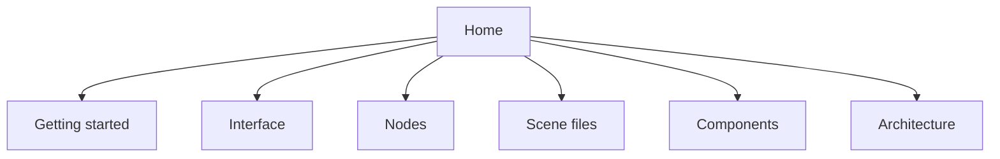

# Editor

This manual describes the scene editor.
The editor is a Vue application.
Open it at `/editor`.
The editor work starts at commit `87d3d185ebca590b43aa3ad3c5dec230c92d7f0c`.
That commit message is `Add a Godot-style editor for creating Three.js meshes.`

The editor follows Godot 4 for docks, nodes, and scenes.
Names follow Three.js when Godot has no matching term.
TSL is one of those terms.
TSL means Three.js Shading Language.

## What you edit

You edit a tree of nodes.
A node can be empty, a mesh, a light, a camera, or a WorldEnvironment.
A mesh uses a geometry and a TSL material.
A component is a three-start behavior.
The behavior class extends `Object3DBehaviour`.

## Routes

The app has two routes.

| Route | What you see |
| --- | --- |
| `/` | The scene fills the window. A link opens the editor. |
| `/editor` | The docks, the menus, and the 3D viewport. |

The two routes show one scene.
They do not boot a second copy.

## One canvas

The scene and the editor share one canvas.
`bootScene()` in `src/webgl/index.ts` builds that world one time.
A later call moves the canvas into the active route.
`EditorState` in `src/editor/state.ts` owns the Three.js objects.
The Pinia store `useEditorStore` is the Vue facade.
The store keeps plain snapshots.
The store does not put a Three.js object in reactive state.

The reason for one canvas is in [PLAN.md](https://github.com/kekkorider/threejs-starter/blob/game-engine/PLAN.md).
The feature list for contributors is in [GODOT.md](https://github.com/kekkorider/threejs-starter/blob/game-engine/GODOT.md).
This manual does not replace those files.

## Starter scene

The first visit to `/editor` wraps the starter objects under a World root.
The floor uses the UV material preset.
The floor position is `[0, 0, 0]`.
The starter cube position is `[0, 1.5, 0]`.
A hemisphere light fills the scene.
A directional light looks at the origin and casts shadows.

Leave `/editor` and the nodes stay in the scene.
The grid, the gizmos, and the badges hide on `/`.
Come back to `/editor` and you see the same world.

## Map

| If you want to | Open |
| --- | --- |
| Run the app | [[Getting started]] |
| Learn the docks | [[Interface]] |
| Select and transform | [[Viewport]] |
| Edit properties | [[Inspector]] |
| Use the keys | [[Keyboard shortcuts]] |
| Add a node | [[Nodes]] |
| Aim a light | [[Lights]] |
| Add a camera | [[Cameras]] |
| Set the sky or the grid | [[World environment and grid]] |
| Share a mesh or a material | [[Geometry and materials]] |
| Write a material | [[TSL]] |
| Save the scene | [[Scene files]] |
| Place a linked scene | [[Instancing]] |
| Add behavior | [[Components]] |
| Edit a script | [[Script editor]] |
| Use groups or signals | [[Groups and signals]] |
| Press Play | [[Play mode]] |
| Undo an edit | [[History]] |
| Read the code path | [[Architecture]] |
| Read the save schema | [[Scene file format]] |
| See missing features | [[Limits]] |
